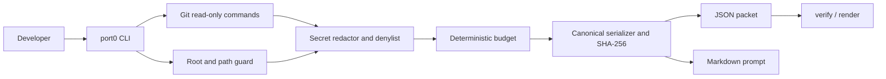

# Port0 Design

## Architecture overview

The CLI is the current shipped surface. It collects Git state, guards every
filesystem read, redacts content, applies section and total budgets, validates
the packet, computes its hash, scans the exact output, and writes atomically.
The core modules are intentionally runtime-neutral so a future static
inspector can reuse schema, redaction, serialization, budget, and prompt logic.

## Components

| Component | Responsibility | Technology |
|-----------|----------------|------------|
| `src/cli/index.ts` | Argument parsing, seven-stage export pipeline, verify, render | Node.js, TypeScript |
| `src/cli/git.ts` | Fixed-argument Git collection and diff parsing | `execa`, Git |
| `src/cli/guard.ts` | Root containment, realpath checks, safe text reads | Node `fs` |
| `src/cli/io.ts` | UTF-8 reads and atomic output writes | Node `fs` |
| `src/cli/errors.ts` | Stable exit-code errors | TypeScript |
| `src/core/schema.ts` | Strict packet and field validation | Zod |
| `src/core/redactor.ts` | Denylist, pattern redaction, packet audit | TypeScript |
| `src/core/budget.ts` | Per-section caps and total-size reduction | TypeScript |
| `src/core/serializer.ts` | UTF-8 ordering, canonical JSON, SHA-256 | Web Crypto API |
| `src/core/prompt.ts` | Web chat, terminal-agent, and teammate Markdown templates | TypeScript |
| `tests/` | Unit, property-style, and golden-fixture coverage | Vitest, fast-check |

## Data model

The packet is a strict JSON object with `schemaVersion`, `port0Version`,
`contentHash`, `intent`, `repo`, `status`, `diffs`, `untracked`, `testLog`,
`redaction`, and `budget`. All paths are relative POSIX paths. No packet field
contains a timestamp, username, hostname, or absolute path.

`contentHash` is SHA-256 over canonical JSON with the hash field removed.
Canonical serialization sorts object keys recursively, sorts path-bearing
arrays by UTF-8 byte order, normalizes text to LF, and appends one newline.

## API / interfaces

| Method | Endpoint / interface | Purpose | Auth required |
|--------|----------------------|---------|---------------|
| CLI | `port0 export [options]` | Capture and write JSON/Markdown | No |
| CLI | `port0 verify <packet.json>` | Validate schema, hash, and secret audit | No |
| CLI | `port0 render <packet.json>` | Print the handoff Markdown | No |
| CLI | `port0 --help`, `--version` | Usage and version information | No |
| TypeScript | `PacketSchema` | Shared strict packet contract | No |
| TypeScript | `computeHash(packet)` | Shared packet integrity calculation | No |
| TypeScript | `renderPrompt(packet, template, options)` | Shared prompt generation | No |

There is no network API, backend, account system, database, or telemetry
interface in the current build.

## Key decisions and tradeoffs

| Decision | Options considered | Chosen | Why | Tradeoff accepted |
|----------|--------------------|--------|-----|-------------------|
| Capture boundary | Whole repository, arbitrary commands, Git state | Git working-tree state | Small, relevant, read-only handoff | Some generated context is not captured |
| Secret handling | Best-effort masking, denylist only, layered approach | Denylist plus content patterns plus final scan | Reduces both file and inline-secret leakage | Unknown custom formats can remain |
| Serialization | Native JSON order, timestamps/IDs, canonical JSON | Recursive sorted JSON and SHA-256 | Reproducible packets and useful integrity checks | Less human control over field order |
| Size control | Hard byte cut, unlimited packet, section-aware budget | Section-aware caps and file/line boundaries | Keeps packet usable and valid | Some context is omitted |
| Git execution | Shell strings, unrestricted Git, argument arrays | `execa` arrays and restricted environment | Avoids shell injection and hostile Git hooks/config paths | More explicit collection code |
| Output writes | In-place write, temp then rename | Atomic same-directory write | Avoids partial packet files | Requires temporary-file cleanup handling |

## AI components

Port0 does not call an LLM. AI is only the receiving tool for the generated
handoff prompt. Port0 validates structure with Zod, redacts known patterns,
audits the final packet, and uses fixed templates. If a redaction pattern is
found after serialization, export fails closed with exit code 3 and does not
write output.

## Security and privacy

### Threat model

| Threat | Mitigation | Residual risk |
|--------|------------|--------------|
| Secret in a diff, log, intent, or branch | Denylist, content rules, final scan, audit report | Unknown/custom secret formats |
| Path traversal or symlink escape | `realpath` and root containment for every read | No known residual issue |
| Git config runs an external diff | Fixed arguments, no ext-diff/textconv, disabled pager/fsmonitor | Unanticipated future Git feature |
| Malformed packet attacks a future inspector | Strict schema, size limit, text-only rendering requirement | Inspector is not shipped yet |
| Prompt injection in code/log data | Templates label packet content as data | Receiving AI may still follow malicious text |

### Data handled

Branch and commit metadata, Git status, staged/unstaged diffs, selected
untracked text files, optional test output, and user-provided intent. Known
secrets are replaced by typed markers; denylisted file contents are omitted.

### Known limits

The hash detects edits but is not a signature. Redaction is pattern-based and
cannot guarantee discovery of every secret. The packet still contains source
code by design, so users must review it before sharing.
